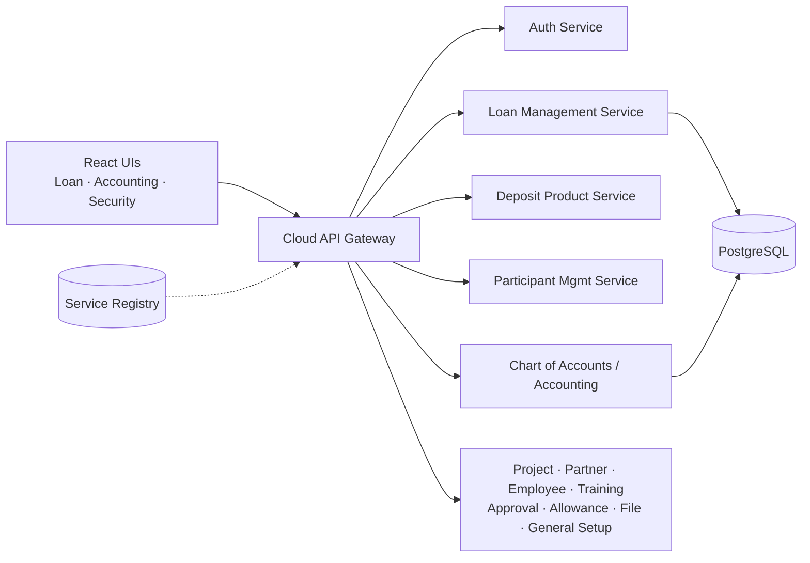

# PKSF IMIS: Integrated Management Information System

**Client:** Palli Karma-Sahayak Foundation (PKSF), Bangladesh's national apex microfinance foundation: 223+ partner organisations, ~20 million people served
**Programme:** RAISE (Recovery and Advancement of Informal Sector Employment), a USD 250M World Bank–supported programme
**Built at:** Nano Information Technology (Nanosoft) · 2026
**Role:** Software Engineer. **Led full-stack development of the Loan Management and Finance & Accounting modules**

---

## The challenge
PKSF funds microfinance through 100+ partner organisations (POs) across the country. Each PO manages participants, loans, deposits and its own accounting books, and PKSF needs one consistent system for all of them, with accurate, auditable financial reporting.

## Architecture
A 19-repository **Spring Boot microservices** platform with React frontends:

## What I delivered
- **Loan Management (service + UI):** loan products and the loan lifecycle for partner organisations, built end-to-end from the Spring Boot service to the React screens.
- **Finance & Accounting:** **delivered and live for 100+ partner organisations.**
  - **Cash Flow Statement (direct method)**
  - **Statement of Changes in Equity**
  - **General Ledger chart-of-accounts hierarchy:** corrected and restructured so reports roll up accurately
- **Cross-service work:** deposit products, participant management, and the cloud API gateway.
- **Quality:** set the integration-testing approach for financial logic, with tests running against **real PostgreSQL rather than mocks**, so reports match production behaviour.
- **Production support:** safe, transactional data fixes for partner organisations: backup first, idempotent, tested on a restored copy.

## Impact
- Finance module live nationwide across 100+ partner organisations
- Core contributor: commits across 7 services and UIs in the platform
- Reliable financial statements that PKSF and its partners can trust

**Stack:** Java · Spring Boot · Spring Cloud Gateway · Spring Data JPA · PostgreSQL · React · TypeScript · Microservices
