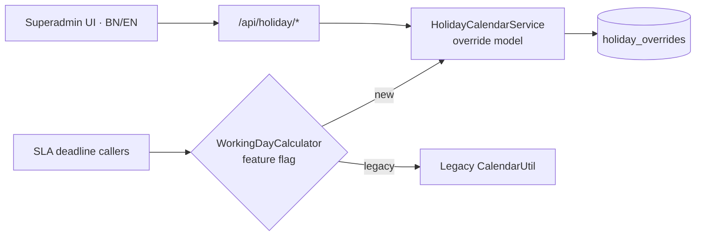

# GRS: Grievance Redress System (Government of Bangladesh)

**Owner:** Cabinet Division, Government of Bangladesh (GRS Cell, with a2i)
**Users:** every citizen of Bangladesh and every government office: a single national channel to file, track and resolve grievances
**Built at:** Nano Information Technology (Nanosoft) · 2026
**Role:** Software Engineer, core contributor

---

## Context
GRS is the national platform where citizens submit grievances to any government office. By law, each grievance must be handled within a statutory number of **working days**. The platform is a large Spring Boot monolith with a mobile app and integration with the government's Doptor office-hierarchy system.

## Highlights

### 1. Holiday & SLA calendar engine
**Problem:** SLA deadlines depended on an external government calendar API that was unreliable. When it failed, the system silently treated every day as a working day, and I also found an off-by-one error when a deadline landed on a holiday.

**What I built:**
- An **override-only data model**: weekends are computed by rule, and the database stores only exceptions (holidays, or weekends that are worked)
- A **bilingual (Bangla/English) superadmin calendar UI**, seeded with the official 2026 government holiday gazette
- A **feature-flag facade** that switches between the new engine and the legacy calculator in-process, giving instant rollback with zero changes at the call sites
- Fixed the deadline-calculation bugs while keeping existing SLA constants meaning exactly what they always meant

### 2. Performance
The grievance list issued **~30 lazy SQL loads per page**. I traced the root cause and built a **projection-based replacement API** that runs alongside the old endpoints, so the frontend can switch over with zero risk.

### 3. Security & policy features
- **OTP verification** for grievance submission
- The Cabinet Division's **new grievance categorisation** system
- A **blacklist system** with a nightly auto-unblock job (36-month retention), plus **mobile APIs and docs** for the Android team
- **UNO auto-assignment** for Upazila offices, a **public GRO directory** (caching, Bengali i18n), and mobile multi-role support

### 4. Architecture: monolith → microservices blueprint
Authored the migration study: **10 Spring Boot services (7 business + 3 infrastructure) plus a React/Vite SPA**, a parallel-build strategy with a single cutover, additive-only schema changes, and a **74-task work breakdown** for project management.

**Stack:** Java · Spring Boot · Thymeleaf · SQL · REST · Mobile APIs · Microservices design
