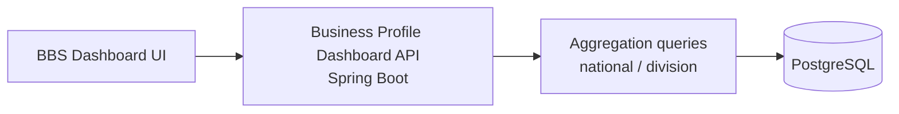

# BBS: Business Survey Platform (Bangladesh Bureau of Statistics)

**Owner:** Bangladesh Bureau of Statistics (BBS), the national statistics agency
**Scope:** survey and business-profile platform for large and medium enterprises, with web, backend and mobile apps
**Built at:** Nano Information Technology (Nanosoft) · 2026
**Role:** Software Engineer, backend

---

## What I delivered
- **Dashboard analytics APIs** in the business-management service: aggregated statistics across national business data
- **Division-level drill-down:** optional geographic filtering via efficient `EXISTS` subqueries
- **Accurate aggregates:** PostgreSQL native queries with explicit numeric casting and clean camelCase DTO mapping
- **Read-optimised:** no transactional overhead on read paths

## Impact
Gives BBS officials fast, filterable insight into large and medium enterprise survey data, nationally and by division.

**Stack:** Java · Spring Boot · Spring Data JPA · PostgreSQL · REST
